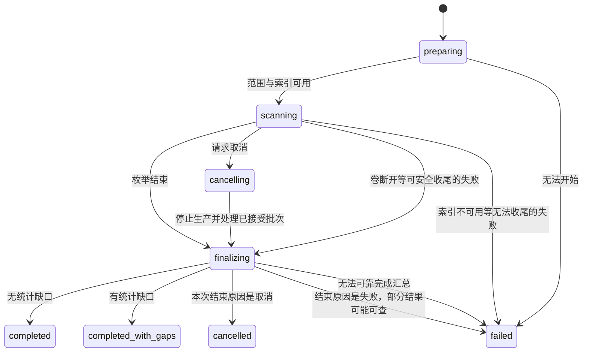
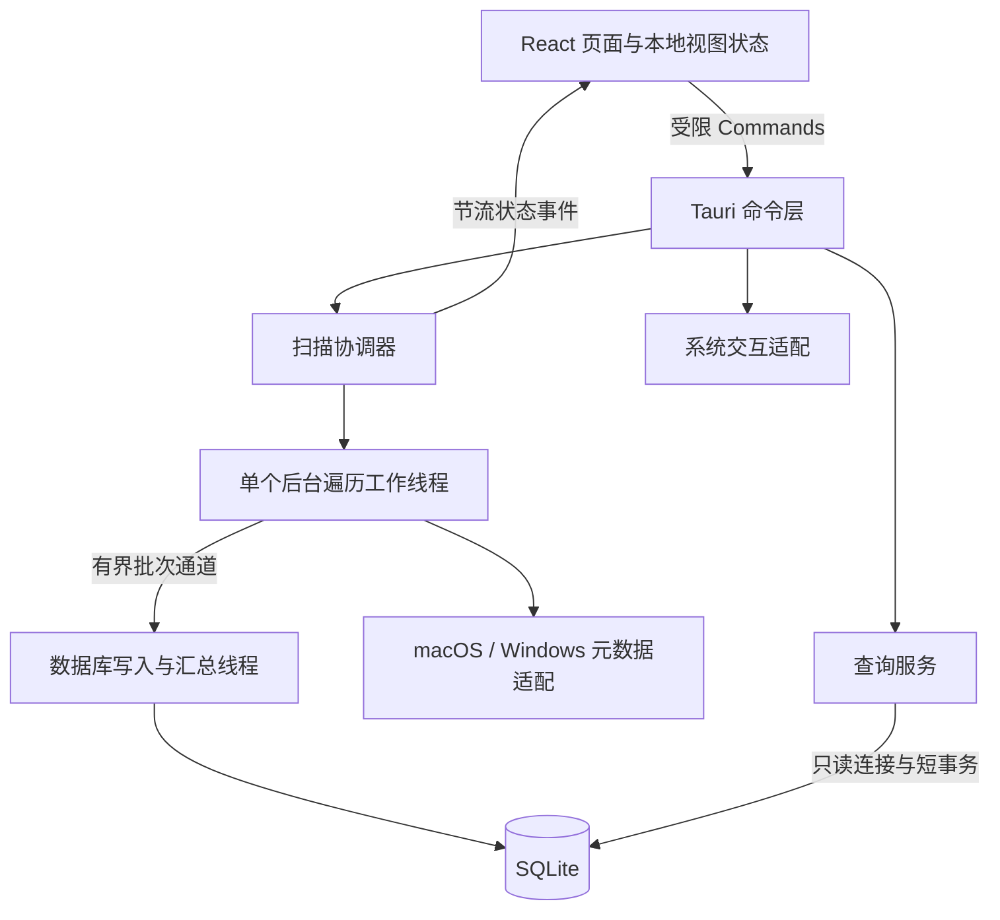

# SpaceLens 空间镜：产品与技术详细设计

版本：V1.0 设计基线\
日期：2026 年 11 月 11 日\
技术方案：Rust + Tauri 2 + React + TypeScript + Vite + SQLite / rusqlite\
适用范围：Mac 首版开发，预留 Windows 适配边界。

本文依据用户已认可的 [产品交互原型](./产品交互原型.html) 编写，承接 [技术选型与初步规划](./技术选型与初步规划.md)。页面结构和交互方向以该原型为基础；本文补充真实扫描所需的数据、状态、接口和异常处理约定。

**空间地图纳入首版。** 初步规划中将其列为后续功能的安排，以本文为准。HTML 中的文件、容量、权限数量和时间均为演示数据，不能作为正式产品的默认结果。本文描述待实现设计，不表示扫描引擎、性能或平台兼容性已经验证。

## 1. 产品目标与版本范围

### 1.1 产品定位

SpaceLens 是一款本地磁盘空间分析工具，帮助用户从卷容量概览找到具体目录和文件，理解其占用的含义，再通过 Finder 等系统工具处理。

用户完成一次使用后，应能回答：

1. 当前磁盘大致还有多少可用空间？
2. 本次扫描范围内，哪些目录和文件贡献了主要占用？
3. 某个大文件的逻辑大小和已分配空间为什么不同？
4. 哪些位置没有扫描到，当前结果有何限制？
5. 如何进入目标目录，或者在系统文件管理器中找到它？

### 1.2 首版范围

| 能力 | 首版约定 |
| --- | --- |
| 平台 | macOS 14 及以上，Apple Silicon 优先；具体最低版本在工程验证时确认 |
| 扫描范围 | 当前用户目录、系统选择器指定的本地目录、本地外置卷 |
| 分析视图 | 空间概览、矩形树图、目录浏览、大文件排行 |
| 基础操作 | 搜索、排序、统计口径切换、容量单位切换、复制路径、Finder 定位 |
| 扫描管理 | 单任务扫描、进度、取消、部分结果、错误与权限说明 |
| 存储 | 本地索引、最近结果、用户偏好，无账户或服务端 |
| 语言与外观 | 中文、浅色主题，沿用原型布局与配色 |
| Windows | 本期定义适配接口，后续单独实现和验收 |

本期不包含删除文件、自动清理、移入废纸篓、内容查重、实时监控、历史对比、报告导出、网络共享扫描、快照删除、Docker 内部分析或特权后台服务。首版不开放未经验证的“完整启动盘扫描”入口。

### 1.3 核心原则

- 已知大小、未知大小、未访问范围分别表达；未知不显示为 0。
- 已分配空间不等于独占物理空间，也不等于可释放空间。
- 文件和目录计量遵循同一套规则，地图、列表和详情解释一致。
- 显示结果始终属于明确的扫描范围、扫描记录和采样时间。
- 系统权限不够时如实报告，不能绕过保护或自动提权。

## 2. 信息架构与视觉规范

### 2.1 主窗口结构

```text
系统标题栏 / 应用名称
┌──────────────┬──────────────────────────────────────┐
│ 品牌与主导航 │ 当前页面标题 / 范围选择 / 扫描操作    │
│              ├──────────────────────────────────────┤
│ 空间概览     │ 卷已用 / 已统计的分配空间 / 卷可用   │
│ 目录浏览     ├─────────────────────────┬────────────┤
│ 大文件排行   │ 面包屑 / 地图或列表     │ 项目详情   │
│ 扫描与权限   │ 搜索 / 口径 / 排序      │ 两种大小   │
│              │ 目录明细 / 扫描缺口提示 │ 路径与操作 │
│ 本地磁盘     │                         │            │
│ 偏好设置     │                         │            │
├──────────────┴─────────────────────────┴────────────┤
│ 当前显示结果状态 / 文件条目数量 / 扫描时间           │
└────────────────────────────────────────────────────┘
```

导航保留五个页面：空间概览、目录浏览、大文件排行、扫描与权限、偏好设置。前三页显示容量摘要；后两页隐藏摘要，给说明与设置留出空间。

本地磁盘列表由系统接口获取，不能沿用示例名称。选择系统卷时默认关联“当前用户目录”这个受支持范围，并明确显示范围；选择外置卷时关联该卷根目录。点击磁盘不会静默启动扫描。没有匹配结果时显示“此范围尚未扫描”。

### 2.2 视觉基准

| 项目 | 规范 |
| --- | --- |
| 品牌 | SpaceLens / 空间镜，沿用绿色柱状图标的视觉方向 |
| 主色 | `#366B58`，用于主按钮与主要选中状态 |
| 正文 | `#242C31` |
| 次级文字 | 以 `#7C858B` 为原型基准；正式版按实际背景校验对比度，必要时加深 |
| 侧栏 / 分隔线 | `#F5F7F5` / `#E9EDEE` |
| 图形颜色 | 沿用原型的低饱和蓝、绿、沙色、紫、青与灰；仅区分项目，不表达删除风险 |
| 标准侧栏 / 详情栏 | 约 204 / 267 逻辑像素，随窗口收缩调整 |
| 页面标题 / 关键数值 | 约 25 / 33 逻辑像素，数值使用等宽数字 |
| 圆角 | 主摘要约 14，按钮约 7，其他小容器约 8～10 |
| 内容留白 | 页面水平约 24～29，区块间距约 16～24 |
| 地图高度 | 标准约 255，大窗口可增至约 290 |
| 字体 | 系统字体；正文约 13，必要辅助文字不低于 11 |

原型中的 9～10 像素文字仅作为密度参考，正式版需要提高可读性。普通文字对比度以至少 4.5:1 为验收目标。不能只通过颜色区分权限错误、当前选中项或统计状态。

### 2.3 窗口与键盘

- 默认窗口建议 1360 × 900，最小建议 960 × 640；在小屏上通过内容滚动保留全部操作，不强制原型的 870 像素最小高度。
- 宽窗口采用三栏；约 1190 像素以下压缩侧栏和详情栏；约 980 像素以下将详情移到内容下方。
- 正式 Tauri 窗口使用系统窗口控制，不复制 HTML 中装饰性的交通灯、外部背景和 24 像素网页外边距。
- `Cmd/Ctrl + K` 聚焦当前页搜索框；无搜索框时不触发。`Esc` 关闭弹窗，不直接取消扫描。
- 所有操作可通过 Tab 和 Enter 使用；弹窗关闭后恢复焦点；地图的小块同时提供列表访问入口。
- 浏览器窄屏预览不构成移动端产品承诺。

## 3. 页面详细设计

### 3.1 空间概览

**目标：** 先看整体，再通过空间地图进入主要目录。

顶部三项摘要采用以下定义：

| 摘要 | 数据来源 | 交互与限制 |
| --- | --- | --- |
| 卷已用容量 | 平台卷信息接口，同一采样的总容量与空闲量 | 不由文件扫描结果反推；解释采样时间与口径 |
| 已统计的分配空间 | 当前显示扫描的根目录分配空间累计 | 固定展示分配量，不随下方“逻辑大小”切换；标注扫描范围和完整性 |
| 卷可用空间 | 平台报告的当前用户可用容量 | 不混用“重要用途可用”等不同指标；不保证与已用量相加恰好等于总量 |

卷信息进入页面时读取，之后最多每 30 秒刷新，并在扫描结束或应用重新激活时更新。扫描合计保持其扫描时间含义，不能伪装成实时文件大小。卷离线后保留值时必须标记“上次记录”，否则显示不可用。

地图区域包括面包屑、当前目录已统计量、空间地图／列表切换、目录明细及扫描缺口提示：

1. 地图只表达当前目录直接子项的已知计量贡献，不绘制整个磁盘或所有后代。
2. 面积按当前口径归一化：`子项计量贡献 / 当前层所有已知贡献之和`。文件列表搜索不改变地图分母。
3. 只为正数贡献绘制面积；已知 0、未知项、链接别名仍保留在列表中，并提供数量提示。
4. 点击文件夹图块进入该目录；点击文件图块选中并打开详情。
5. 地图与列表切换保留目录、选择项和统计口径。
6. 未访问位置在地图外显示“有 N 处内容未计入”；不能用零面积悄悄隐藏。

**大量子项的处理：** Rust 返回当前层贡献最大的 40 项，以及其余已知贡献的汇总。地图最多绘制 41 块；列表仍可分页访问全部子项。汇总块命名“其他 N 项”，点击后在同层列表展示该组，不形成虚构目录。

汇总块没有磁盘路径，不提供复制路径或 Finder 定位。进入后列表显示可取消的“其他 N 项”筛选标记；移除标记回到当前层全部项目，面包屑不增加虚构路径。分组贡献和前 40 项之和必须等于当前层已知总量。图块太小时省略文字，通过悬浮提示、可访问标签和列表查看详情，不能放大面积来容纳文字。

布局可沿用原型的按权重递归分割算法；口径切换后重新计算几何，同一结果内颜色保持稳定。采用 `BigInt` 字节值计算比例后再转为有限浮点数，禁止先将完整字节量粗略取整。

### 3.2 目录浏览

**目标：** 在已扫描范围内逐层查明细。

列表字段：名称与类型、当前口径的计量贡献、占当前目录已知量的比例、进入／详情操作。详情始终可以看到原始大小与归属解释。

- 单击名称只选中；点击行末箭头或详情“进入此目录”下钻。真实空目录也可以进入，显示空态。
- 面包屑只包含当前扫描根及其后代，不能借此访问未扫描的祖先。
- 搜索作用于当前层项目的展示名称与路径，不递归扫描磁盘。提示文案为“搜索当前目录”。
- 输入停顿约 250 毫秒后查询，清空搜索恢复全部当前层项目。
- 默认按当前口径降序；未知值始终放在末尾，同值以条目 ID 排序，保证翻页稳定。
- 默认每页 100 条，界面按需加载；切换排序、目录或过滤条件清空旧游标。
- 显示“已统计 X · 有未知内容”与“已知 0 B”时必须采用不同状态文案。

### 3.3 大文件排行

**目标：** 快速找到扫描范围内最大的普通文件。

数据范围是当前显示扫描中的全部普通文件，不包含目录、虚拟分组或未枚举到的内容。按文件身份去除硬链接重复项，以本次归属路径代表该文件，详情可以分页查看其他路径。

字段：文件名、父路径、当前口径大小、文件类型、详情操作。初始安装默认按已分配空间降序；之后遵循已保存默认值和当前会话口径，不因进入排行页重置口径。不设置隐含的最小文件大小阈值。

- 搜索当前扫描范围中的普通文件名称与展示路径，文案为“搜索文件名或路径”。
- 切换逻辑大小后，虚拟磁盘等稀疏文件可能显著上升，这是预期结果。
- 点击文件只显示详情；需要进入其所在目录时，通过详情中的“浏览所在目录”进入目录浏览页，并定位该行。
- 文件类型首先按已知元数据或扩展名说明；不打开正文做内容识别。
- 大小为未知的文件保留在末尾，不能因为无法排序就从结果中删除。

首版不增加尚未在原型中确认的复杂过滤面板。大小阈值、组合类型筛选可在基础流程稳定后单独评估。

### 3.4 扫描与权限

**目标：** 说明本次扫描完成到了哪里，哪些结果不可知。

页面包含当前扫描状态、已提交文件条目数、访问错误数量、错误位置列表、授权指引和重新扫描入口。权限徽标只反映当前选定范围对应的扫描，不使用固定数字。

错误列表字段：路径、阶段、错误类别、简明原因、大小状态和可采取的动作。首次只加载一页，错误较多时分页查询。

| 情况 | 用户提示 | 可执行动作 |
| --- | --- | --- |
| 受隐私权限或文件权限限制 | 此位置未能访问，未计入完整统计 | 查看授权指引、重新扫描 |
| 文件在扫描中消失 | 文件已移动或删除，当前记录不完整 | 重新扫描 |
| 元数据不可用 | 部分大小未知 | 查看错误详情、重新扫描 |
| 外置卷断开 | 磁盘已断开，扫描未完成 | 重新连接后重新扫描 |
| 根目录无法打开 | 未能开始扫描该范围 | 更换范围或处理权限 |

macOS 不应仅凭一个全局布尔值宣布“完全磁盘访问已授权”。授权指引解释如何在系统设置中允许应用访问，真实覆盖情况依据扫描时的具体访问结果判断。

首版授权后的恢复方式是重新扫描整个选定范围，不做局部结果拼接。这样避免新旧采样数据和硬链接归属混合。

### 3.5 偏好设置

| 设置 | 默认值 | 生效方式 |
| --- | --- | --- |
| 容量单位 | 二进制，B / KiB / MiB / GiB / TiB | 保存后立即更新所有大小展示，不改数据库或排序 |
| 默认统计口径 | 已分配空间 | 保存后同步当前视图，并作为下次启动默认值 |
| 包含隐藏目录 | 开启 | 首版固定策略，作为说明展示 |
| 跟随符号链接 | 关闭 | 首版固定策略，作为说明展示 |

分析页的口径切换只改变当前会话，不自动覆盖偏好设置。容量单位按值选择合适量级，悬浮或详情可显示精确字节数；默认最多保留两位小数。

偏好写入应用设置表，失败时保留原值并显示“设置未保存”。首版不在偏好页加入清理索引、后台扫描、账户或更新渠道等额外功能。

### 3.6 项目详情与系统操作

详情字段包括：名称、真实类型、完整展示路径、原始分配大小、原始逻辑大小、计入本位置的贡献、所属卷、扫描完整性、扫描时间、用途线索和大小口径说明。

“计入本位置的贡献”在存在硬链接或部分数据时重点展示；普通项目可简化显示。用途说明由有限本地规则给出，例如路径匹配到 Docker 虚拟磁盘时说明稀疏文件，不能据此宣布可删除。

| 操作 | 规则 |
| --- | --- |
| 进入此目录 | 真实目录可进入；从权限／设置／排行页操作时切换到目录浏览 |
| 浏览所在目录 | 文件项目进入父目录，保留文件为选中项 |
| 在 Finder 中显示 | Rust 根据扫描 ID 和条目 ID 查找原始路径，复核路径和文件身份后调用系统接口 |
| 复制路径 | 复制展示路径；若存在无法无损转成文本的字符，明确提示这是展示形式 |
| 大小说明 | 解释当前记录使用的大小来源及共享块、快照等限制 |

已消失、被替换或离线的项目不假装定位成功。虚拟分组没有文件操作。页面没有选中项时，详情面板显示“选择一个项目查看详情”。

## 4. 页面状态与导航契约

### 4.1 前端状态

| 状态 | 含义 |
| --- | --- |
| `selected_scope_id` | 用户当前查看或准备扫描的范围 |
| `display_scan_id` | 当前分析视图展示的已封存扫描记录，可为空 |
| `active_scan_id` | 正在执行的扫描记录，可为空，与显示结果分离 |
| `page` | 五个主页面之一 |
| `folder_id` / `selected_entry_id` | 当前目录与选中条目，均属于显示扫描 |
| `metric` / `unit_mode` | 当前统计口径与单位制 |
| `query` / `sort` / `cursor` | 当前列表的搜索、排序与分页状态 |
| `group_token` | 当前层“其他 N 项”的筛选令牌，可为空，不代表真实目录 |
| `request_seq` | 请求序号，用于丢弃过时响应 |

首次会话使用已保存的默认口径；主页面之间继承当前 `metric`。切换主页面清空搜索和分页游标。目录下钻清空搜索并回到第一页。切换口径保留目录与有效选中项，但重置分页。切换范围清空目录、选择项、搜索和旧查询状态，只有范围匹配的已保留结果才可重新绑定。切换页面、目录、范围或口径时均清除 `group_token`，避免保留不可见或失效的分组过滤。

扫描期间允许浏览当前范围的旧结果、切换页面和修改显示口径；禁止启动另一扫描和切换扫描范围。界面禁用与 Rust 校验同时生效。

### 4.2 必须提供的空态与异常态

| 状态 | 主内容 | 操作 |
| --- | --- | --- |
| 首次启动 / 范围未扫描 | 未扫描，不显示 0 容量分析结果 | 选择范围、开始扫描 |
| 首次扫描中 | 当前阶段、已提交数量、路径与耗时 | 取消 |
| 重扫中 | 上次结果，清楚标记上次时间；另显示本次进度 | 浏览、取消 |
| 正在取消 / 整理部分结果 | 保留原视图，说明正在安全收尾 | 不重复启动 |
| 扫描完整完成 | 已封存结果及完成时间 | 继续分析、重扫 |
| 扫描部分完成 | 已知结果及缺口标识 | 查看错误、重扫 |
| 已取消 | 上次结果或未完成空态；可用时提供部分结果入口 | 查看部分结果、重扫 |
| 扫描失败 | 失败原因，上次结果仍可用时保留 | 更换范围、重试 |
| 空目录 | 已知空目录，0 B | 返回上级 |
| 搜索无结果 | 搜索条件没有匹配项 | 清空搜索 |
| 卷离线 / 路径失效 | 已保存结果附上离线或失效标识 | 重连、重扫 |
| 旧索引或上次中断 | 标明旧时间或中断状态 | 重新扫描 |

索引是一次非原子的扫描记录，应用不监控其后所有变更。界面始终显示扫描时间；不能因为存在本地索引就标为“当前准确占用”。

## 5. 空间统计与文件系统规则

### 5.1 字节与未知值

原始字节量使用整数，未知使用可空值，禁止用 `0`、`-1` 或空字符串代表未知。文件原始大小与目录计量贡献是不同字段。

| 字段概念 | 定义 |
| --- | --- |
| 原始逻辑大小 | 文件元数据报告的数据长度，具体流／分叉口径由平台方法标识 |
| 原始分配大小 | 平台文件系统报告的分配量，保留计量方法 |
| 直接计量贡献 | 去重与扫描策略处理后，该条目本次贡献的大小 |
| 目录已知累计量 | 已发现子项的计量贡献自底向上累计 |
| 未知量计数 | 对当前指标大小未知的条目或未完成子树数量，不是未知字节数 |
| 完整性 | 元数据是否完整、目录枚举是否结束、是否存在访问或收尾缺口 |

目录扫描完且确认为空时显示 0 B；完全无法枚举时显示“未知”；已有部分已知数据时显示“已统计 X，有内容未知”。已知累计量并不保证是独占物理空间的数学下界，APFS 共享块仍可能重复报告。

目录自身元数据、文件系统管理结构、快照等不混入普通文件的累计值。地图占比基于同层贡献，而非整个磁盘容量。

### 5.2 Mac 首版计量方法

首版基准采用 Rust `symlink_metadata` 所提供的非跟随元数据，普通文件逻辑长度取 `len()`；分配量取 macOS `stat` 报告的 `st_blocks × 512`，以受检查的整数运算换算字节。记录方法标识 `macos_stat_blocks_v1`。

[Rust 标准库 MetadataExt::blocks 文档](https://doc.rust-lang.org/std/os/unix/fs/trait.MetadataExt.html#tymethod.blocks)明确规定返回值以 512 字节为单位，并说明稀疏文件的分配块数可能小于逻辑长度；该说明已于本文编写日读取核对，仍需 Mac 样本验证。

这是**系统报告块数口径**，不命名为“精确物理大小”。逻辑长度不承诺包含所有资源分叉；分配块数中元数据、压缩或分叉的覆盖由文件系统报告决定，本版不逐项拆解。以稀疏、压缩、资源分叉及普通文件样本核验该口径后再作为发布基线。

Foundation 的分配量属性可用于技术验证和对照，但不在同一次扫描里悄悄替换部分文件的来源。若验证后必须改变主方法，更新方法版本、说明与样本期望值，新建扫描记录，不混合不同版本。

卷容量分别保留总容量、空闲容量、当前用户可用容量、方法和采样时间。只有能用同一来源解释时才派生“卷已用”；否则显示系统返回的独立指标或未知。APFS 共享容器的多个卷不能直接相加形成“整盘占用”。

### 5.3 硬链接与计量归属

1. 普通文件按“设备／卷身份 + 文件身份”识别同一文件；Mac 采用同次扫描中的设备 ID 与 inode。
2. 第一个成功读取必要元数据并提交的路径成为本次归属项，其他路径记录 `canonical_entry_id`。
3. 每个路径保留自己的原始大小，但只有归属项对目录累计贡献；别名的贡献为 0，并明确标记“已计入另一位置”。
4. 列表不能把别名表现为真实的空文件：主计量列旁展示归属标识，详情显示原始大小和归属路径。
5. 地图不为零贡献别名绘制面积；排行按文件身份去重，详情可查看其他路径。
6. 文件身份不可用但大小已知时，该路径仍贡献已知大小，同时记录并向祖先传播 `dedup_uncertain_count`，显示“可能重复统计”。排行也保留该路径并标记身份未知；不将其计为 0，也不宣称已经去重。身份与大小都未知时分别记录两类缺口。

归属规则使同层累计可加，但不是文件独占空间的归属证明。更换扫描范围或发现顺序可能改变各目录分摊；首版不支持跨扫描差异分析。APFS 克隆共享块不能用 inode 去重解决。

### 5.4 遍历边界

| 对象或情况 | 处理方式 |
| --- | --- |
| 普通文件 | 读取必要元数据，不读取正文，按所选方法计量 |
| 目录 | 枚举可访问子项，逐层累计；记录枚举是否正常结束 |
| 包目录，如 `.app`、照片图库 | 按目录枚举元数据，界面可显示包类型，不能因折叠外观漏计 |
| 符号链接 | 记录链接项，不跟随目标，不计入普通文件大小累计 |
| 挂载点 / 跨卷目录 | 记录“按策略跳过”，不自动跨入；作为单独范围才扫描 |
| 套接字、设备等特殊项 | 记录类型并跳过内容和分配量累计 |
| 云端占位文件 | 仅请求不主动下载内容的元数据；不可获得的量保持未知 |
| APFS 快照 / 克隆 | 解释限制，不遍历隐藏快照、不猜测独占释放量 |
| 启动盘映射 | 首版使用用户目录和明确选定目录，不对 `/` 与 Data 卷重复求和 |
| 应用自身索引与日志目录 | 显式按策略排除并记录原因，避免扫描期间索引增长影响自身计量 |

按策略排除与访问失败分开计数。即使没有错误，“完整完成”也只表示按这些既定边界完成目录扫描，不表示覆盖卷的全部物理空间。

## 6. 扫描生命周期与结果发布

### 6.1 一次只运行一个扫描

首版不做暂停、断点续扫或多任务并行。状态与“结果是否可查询”独立保存：

| 内部状态 | 界面含义 | 进入条件 |
| --- | --- | --- |
| `preparing` | 正在准备 | 校验范围、卷身份、索引可写性 |
| `scanning` | 正在扫描 | 枚举和元数据读取进行中 |
| `cancelling` | 正在取消 | 收到取消请求，停止新工作 |
| `finalizing` | 正在整理结果 | 排空已接受批次，汇总已知量与缺口 |
| `completed` | 扫描完成 | 正常遍历结束，无未解释的统计缺口 |
| `completed_with_gaps` | 部分完成 | 正常结束但有访问、元数据或去重缺口 |
| `cancelled` | 已取消 | 收尾完成，保留可查询部分时明确不完整 |
| `failed` | 扫描失败 | 根无法访问、卷断开、数据库等致命错误 |
| `interrupted` | 上次扫描中断 | 下次启动发现非正常退出的活动记录 |



准备阶段收到取消直接停止；正常汇总阶段收到取消保存取消意图，安全完成或停止汇总后落为 `cancelled`，不把“取消请求已收到”当作任务已经退出。已发生的致命失败优先于后来的取消意图，不能把失败改写成正常取消。所有活动状态在异常退出后可于下次启动转为 `interrupted`。

卷断开等错误在数据库仍可用时先以 `end_reason = failure` 进入汇总，成功封存后落为 `failed + has_queryable_result = true`；索引不可用或汇总失败则落为 `failed + has_queryable_result = false`。只在最终字段落库后发出终态通知，终态 `failed` 不再返回汇总阶段。

### 6.2 进度与分析结果分离

采用与原型一致的方式：**扫描时展示进度，分析视图展示已经封存的结果。**

- 开始扫描分配新 `scan_id`，不覆盖上次记录。
- 重扫时继续展示上次结果，注明“正在扫描，当前显示上次结果（时间）”。
- 首扫没有旧结果时显示进度空态，不生成不断变化的目录排行榜。
- 进度包含阶段、已提交文件条目数、已提交已知量、当前路径、错误数量与耗时，不显示未经验证的百分比或剩余时间。
- 正常结束并完成汇总后，事务性设置结果可查询、版本和展示指针，再通知前端切换。
- `completed_with_gaps` 可以自动展示，但必须同时显示部分完成状态。
- 取消或失败不自动覆盖旧结果。新部分结果可查询时提供“查看本次部分结果”；用户打开后整套视图都绑定这份部分记录。
- 根卷断开时终态为 `failed`，已经提交的数据只有在汇总成功后才可查询；数据库写满等情况下不能保证存在部分结果。

取消后，扫描器停止枚举，已接受的批次完成一致性处理；未关闭的祖先目录传播“枚举未完成”。在操作系统调用阻塞时，界面保持“正在取消”，不通过假完成隐藏仍在执行的工作。

### 6.3 保留与恢复

仅保留最多两代扫描数据：一份已展示结果，以及当前／最近一次尝试。它们可以属于不同范围；没有保留结果的范围显示未扫描，不借用其他范围数据。

下一次扫描前，保留当前展示结果，释放另一代过期应用索引，再创建新尝试。清理只针对应用自身索引，不触碰用户被扫描文件。结果切换后，已经发出的旧查询允许正常结束，不能让已返回页面继续引用被清除的条目。

异常退出后，把未封存活动记录标记为 `interrupted`，不自动续扫，也不将未汇总的数据开放为目录总量。上一份封存结果可继续使用；首次扫描中断时提示重新扫描。数据库损坏时说明索引不可用，经明确的重建操作重新生成应用索引，不静默声称旧结果仍正确。

## 7. 技术架构与模块职责

### 7.1 架构



不引入服务端、通用插件框架或单独的后台进程。Tauri 负责窗口和 IPC，不承担文件系统统计语义；React 不直接读取任意路径。

### 7.2 模块划分

| 模块 | 职责 | 不承担的职责 |
| --- | --- | --- |
| `ui/pages` | 五个页面、空态、错误提示 | 文件扫描与系统权限判断 |
| `ui/components` | 地图、列表、详情、范围选择 | 持有全部文件记录 |
| `ui/services` | 类型化命令调用、请求序号、事件订阅 | 拼接 shell 命令 |
| `commands` | 参数解析、范围与条目校验、错误映射 | 直接执行长时间阻塞遍历 |
| `scan/coordinator` | 唯一活动任务、取消、阶段与发布 | 绘图、页面状态 |
| `scan/walker` | 目录遍历、边界识别、元数据采集 | 将所有路径缓存到内存 |
| `scan/accounting` | 计量规则、硬链接归属、完整性传播 | APFS 独占块推断 |
| `storage` | 迁移、批量写入、汇总、分页查询 | 文件内容分析 |
| `platform` | 原生路径、文件身份、大小来源、卷信息、系统操作 | 改写共用统计规则 |
| `rules` | 少量路径与应用类型的说明规则 | 自动判定安全删除 |

建议在单个 Tauri 工程内组织以上目录。Rust 使用 `walkdir` 或等价遍历工具处理基础枚举，但链接、挂载点、云端项和错误语义由平台适配层补齐。数据库使用 `rusqlite`，不同时引入另一套 ORM。

### 7.3 线程、批次和聚合

初始参数作为可测试默认值：每批最多 500 个条目或约 2 MiB 元数据，队列最多 8 批；有数据时最长约 250 毫秒提交一次批次。极长单条路径单独受大小上限约束，不因凑满批次而无限等待。

1. 工作线程读取元数据，遇到取消或范围失联停止生产。
2. 有界通道产生背压，数据库较慢时暂停枚举，不无限扩展内存。
3. 数据库线程在同一事务内写入条目、归属关系、错误和已提交计数。
4. 遍历结束后按深度从深到浅分批汇总目录，累计已知量并传播未知与未完成标记。
5. 汇总完成前 `has_queryable_result = false`。封存后结果保持不变，不需要为每次写入维护前端列表版本。

聚合采用受检查的整数加法，不能只依赖可能溢出的 SQL `SUM`。任何溢出应形成明确错误与未知标记，不能截断、回绕或默默改成浮点数。

SQLite 开启外键约束和 WAL，单写入连接，独立短事务读取连接；设置有限 busy timeout，并将最终失败返回为可解释错误。阶段结束做适度 checkpoint，避免长读事务导致 WAL 不受控增长。

## 8. 本地数据设计

### 8.1 核心表

以下是字段与约束设计，不是已创建的数据库。

| 表 | 核心字段 |
| --- | --- |
| `scans` | `scan_id`、唯一的 `start_request_id`、启动参数摘要、`scope_key`、原始根路径及编码、展示根路径、卷身份、平台、计量方法与策略版本、状态、结束原因、起止时间、提交计数、错误及去重不确定计数、`has_queryable_result`、完整性、`result_revision` |
| `entries` | `scan_id`、`entry_id`、`parent_id`、深度、原始名称及编码、展示名称／路径、类型、文件身份、原始逻辑／分配字节、`canonical_entry_id`、直接贡献、已知累计量、各指标未知计数、`dedup_uncertain_count`、未完成子树计数、修改时间、枚举状态、用途规则 ID |
| `file_identities` | `scan_id`、卷／设备身份、文件身份、`canonical_entry_id`；用于归属去重 |
| `scan_errors` | `error_id`、`scan_id`、可空条目 ID、原始错误路径、展示路径、阶段、类别、系统错误码、影响的指标、发生时间、简明说明 |
| `app_settings` | 设置键、JSON 值、设置版本；保存单位制和默认口径 |
| `app_state` | 当前展示扫描 ID、数据库结构版本等少量应用状态 |

一个根条目没有父项。条目身份的唯一键为 `(scan_id, entry_id)`，父项和归属项必须属于同一扫描。文件身份唯一约束为 `(scan_id, volume_identity, file_identity)`；身份未知时不创建假身份记录。

直接贡献和目录累计分开保存：普通文件按归属规则贡献，目录从子项汇总。未知计数用于解释当前指标的不完整性，不直接转成估计字节量。

无法访问的子项在枚举能获得其名称时仍创建条目并记录错误；根本未枚举出的后代不虚构名称或条目数，只记录父目录枚举缺口。

### 8.2 索引与查询

- 目录查询索引：`scan_id + parent_id + 当前指标状态 + 当前指标大小 + entry_id`；逻辑与分配口径分别建立必要索引。
- 排行查询索引：扫描 ID、普通文件／归属项标记、指标状态、原始大小、条目 ID。
- 错误查询索引：扫描 ID、错误类别、错误 ID。
- 首版搜索采用参数化的名称／展示路径子串匹配，区分当前层和扫描范围。无需首期引入全文检索库。
- 名称搜索只影响展示，不用于判断路径相同。展示搜索可使用预计算的 Unicode 规范化检索字段，原始路径保持不变。
- 百万文件范围子串搜索可能无法有效利用普通 B-tree 索引，应采用独立查询任务、取消机制和有限结果页；性能目标未达标时再评估专用搜索索引。
- `%`、`_` 等用户字符作为字面搜索内容处理，不能让 SQL 通配符改变语义；所有参数绑定，排序字段使用后端枚举白名单。

列表不以路径字符串作为业务 ID。虚拟“其他 N 项”由查询生成分组令牌，不作为真实文件条目写入库。

### 8.3 数值、路径与时间

| 数据 | 存储与传输 |
| --- | --- |
| 字节数 | Rust 非负整数 / 可空；SQLite 使用有符号 64 位并检查范围；IPC 使用十进制字符串或 `null` |
| 大计数、条目 ID | IPC 使用十进制字符串；前端不使用浮点 Number 承担精确运算 |
| 文件身份 | 平台原生值或无损二进制组合；不按展示字符串推断 |
| Unix 路径 | 保留原始字节分量，不能仅保存有损 UTF-8 展示值 |
| Windows 路径 | 后续保留平台 UTF-16 分量，不手动替换斜杠拼接 |
| 时间 | 存 UTC 时间戳；界面按用户系统时区显示，不能硬编码“今天” |

对于超过 SQLite 可表示范围或乘法溢出的元数据，记录 `size_overflow` 并令对应大小未知。前端仅在格式化或归一化绘图比例时转换为有限小数。

应用数据保存在平台应用目录，Mac 为 Application Support 下的应用专属目录，Windows 后续使用 Local AppData。数据库含私人路径，不上传；日志默认不记录完整个人路径或文件内容。

## 9. Tauri 前后端接口契约

### 9.1 命令清单

以下为项目自定义 Commands，名称与参数是实现约定，并非声称 Tauri 内置同名 API。

| 命令 | 主要输入 | 返回与规则 |
| --- | --- | --- |
| `get_app_state` | 无 | 启动恢复处理后的当前展示 ID、活动 ID、保留扫描摘要、范围描述和最新状态，供首次加载／重连发现记录 |
| `list_volumes` | 无 | 实际卷列表、身份、容量采样、可扫描状态 |
| `choose_scope` | `kind: home / volume / directory`，可选卷 ID | 后端解析或打开系统选择器，返回范围描述及 `scope_id`；取消返回空 |
| `start_scan` | `scope_id`、`request_id` | 新扫描 ID；同一请求 ID 和相同参数返回原记录，同 ID 参数不同拒绝，已有其他任务时返回忙 |
| `cancel_scan` | `scan_id` | 返回已接受／已结束状态，幂等，不等价于立即完成 |
| `get_scan_status` | `scan_id` | 最新阶段、提交计数、错误、结果可查询性及结束原因 |
| `get_result_summary` | `scan_id` | 封存根统计、范围、时间、计量方法和完整性 |
| `list_children` | `scan_id`、`parent_id`、口径、搜索、排序、游标、页大小 | 当前层条目页；只查询封存结果 |
| `get_directory_map` | `scan_id`、`parent_id`、口径 | 前 40 项、其他组令牌与总量、未知和零贡献计数 |
| `list_large_files` | `scan_id`、口径、搜索、排序、游标、页大小 | 按文件身份去重的普通文件页 |
| `get_entry_detail` | `scan_id`、`entry_id` | 原始大小、贡献、完整路径、归属与用途说明 |
| `list_entry_aliases` | `scan_id`、`entry_id`、游标、页大小 | 同一文件的其他已扫描路径 |
| `list_scan_errors` | `scan_id`、错误类别、游标、页大小 | 错误位置与原因，不查询文件正文 |
| `show_result` | `scan_id` | 明确切换到可查询的已保留结果，校验范围 |
| `reveal_entry` | `scan_id`、`entry_id` | 校验后调用 Finder；失败返回结构化原因 |
| `copy_entry_path` | `scan_id`、`entry_id` | 通过受限剪贴板能力复制展示路径，并返回是否为有损展示 |
| `open_permission_settings` | 固定的权限指引类型 | 仅打开预定义系统设置位置；失败时返回手动路径说明 |
| `get_settings` / `update_settings` | 设置白名单及预期版本 | 返回已保存配置；未知键或非法值拒绝 |

地图的“其他组”由 `list_children` 的可选 `group_token` 过滤参数展开；令牌绑定同一扫描、目录和口径，不接受任意路径或任意 SQL。

`start_request_id` 与范围和参数摘要一同持久化，幂等保证覆盖该扫描记录保留期内的进程重启。记录已按两代保留策略清除后不再保证旧请求的幂等性；前端重连先通过 `get_app_state` 对账，不重放过期启动请求。新的用户扫描动作生成新的请求 ID。

### 9.2 分页与一致性

默认页大小 100，后端最大 200，地图最多 41 块。使用后端生成的不透明 keyset 游标，绑定扫描 ID、结果版本、排序方向、指标、搜索条件、分组和最后一项排序键。

排序顺序为：已知／部分已知项在前，纯未知在后；同组按大小升降序，再按条目 ID 固定次序。目录的部分已知量可参与排序，但必须携带不完整标识。

所有响应返回 `scan_id`、`result_revision`；前端再校验请求序号。范围、目录、口径或搜索切换后返回的旧响应直接丢弃，不能覆盖新页面。过期或不匹配游标返回 `cursor_invalid`，前端重新请求第一页。

封存结果内部不再更新大小，`result_revision` 在封存时确定。实际文件后续变化通过新扫描反映，不修改旧索引来假装实时。

示例响应结构：

```json
{
  "scan_id": "scan-example-01",
  "result_revision": "1",
  "parent_id": "100",
  "metric": "allocated",
  "items": [
    {
      "entry_id": "101",
      "name_display": "Library",
      "kind": "directory",
      "known_bytes": "10737418240",
      "unknown_item_count": "2",
      "coverage": "partial",
      "is_alias": false
    }
  ],
  "next_cursor": null
}
```

### 9.3 进度事件与错误

事件 `scan_progress` 最多约每 250 毫秒一次，包含扫描 ID、单调递增序号、阶段、已提交条目数、已提交已知量、错误数、耗时和当前路径。仅发送聚合数据，不逐文件发送 IPC。发生阶段变化或结束时立即通知。

前端先注册监听，再通过 `get_app_state` 发现当前与保留记录，然后获取对应扫描状态；重连、窗口恢复和事件缺失时用 `get_scan_status` 对账。恢复范围使用后端重新核验的描述与 `scope_id`，不能将旧展示路径直接传回充当授权。事件用于通知，持久化状态是判断终态的依据。扫描结束事件丢失不能导致界面永久显示扫描中。

统一错误返回包含 `code`、用户可读说明、可重试性、可选系统错误码和关联扫描 ID。关键错误码至少包含：

`scan_busy`、`scope_invalid`、`request_conflict`、`permission_denied`、`entry_missing`、`entry_replaced`、`volume_disconnected`、`metadata_unavailable`、`identity_unavailable`、`size_overflow`、`result_not_ready`、`result_expired`、`cursor_invalid`、`database_full`、`database_unavailable`。

文件级错误进入扫描错误列表并尽量继续；根范围或索引无法可靠工作时停止扫描。用户看到的错误消息不直接暴露数据库查询文本或内部堆栈。

## 10. 系统适配、权限与数据边界

### 10.1 平台接口边界

| 能力 | Mac 首版 | Windows 后续 |
| --- | --- | --- |
| 文件类型和身份 | 非跟随 stat 元数据、设备与 inode | 文件句柄信息、卷身份与 File ID |
| 逻辑 / 分配大小 | 本文指定的 Mac 方法 | 选定 Win32 方法后验证 NTFS 稀疏与压缩语义，记录独立方法版本 |
| 链接与边界 | 符号链接、挂载点、启动卷映射 | symlink、junction、reparse tag 与云文件提供程序标志 |
| 卷信息 | 系统卷列表与容量接口 | 本地卷与容量接口，盘符只作为展示 |
| 选择与定位 | 系统目录选择器、Finder | 系统目录选择器、资源管理器 |
| 权限说明 | 隐私权限、Unix 权限及系统保护 | ACL、受保护目录与标准用户权限 |

Windows 不能把所有重解析点一概当成相同链接，也不能为获得大小触发云文件下载。网络共享、设备卷、长路径和云盘分别验证；第一版 Windows 先承诺经过测试的本地文件系统范围。

### 10.2 范围授权与命令校验

- 前端通过系统选择器或后端预设获得 `scope_id`，后续不接受任意前端路径作为扫描授权。
- `scope_id` 表示应用记录的用户选择，不是操作系统授权令牌；TCC、Unix / ACL 权限仍独立生效。
- 原始根路径、卷身份和文件身份保留在 Rust；再次使用已保存范围时重新核验。
- 若用户选中的根本身是链接，解析并向用户展示实际根后再绑定；扫描后代不跟随链接。
- 目录归属按原生路径分量、已保存父子关系及平台身份校验，不能只做字符串前缀判断。
- 目录打开和元数据读取尽量采用非跟随、句柄相对的方式，并复核身份，避免扫描期间链接替换导致越界。异常变化记为缺口，不追踪到新目标。
- 文件定位以扫描条目为入口并重新核验，不接受 shell 字符串或可任意拼装的系统命令。

### 10.3 Tauri 与系统分发

Tauri capability 只授予可信本地窗口所需的命令、事件、目录选择、剪贴板和定位能力。没有通用 shell 执行、任意文件写入或远程页面 IPC。具体 capability 与 CSP 写法以工程所用版本验证，不能把系统权限与 WebView 权限混为一谈。

文件名、路径和系统错误文本均视为数据，在 React 中按文本渲染；正式页面不沿用原型通过拼接字符串生成界面的方式。前端不加载远程页面、字体、统计脚本或任意外部资源。

Mac 首版采用普通用户运行，面向后续 Developer ID 签名与公证的站外分发设计，不以 App Store 沙盒为首发约束；不使用 root、关闭系统保护或安装特权辅助程序。公开分发和签名不属于本次文档任务的执行范围。

## 11. 性能目标与资源控制

以下是实现验收目标，不是已经实测的产品能力。基准机先按 Apple Silicon、16 GB 内存、本地 APFS SSD 设置，并记录具体机器与系统版本。

| 项目 | 初始目标 / 约束 |
| --- | --- |
| 数据规模 | 至少覆盖约 100 万文件条目与 10 万级目录 |
| 列表查询 | 封存结果、缓存正常时，100 条目录／排行页 p95 目标不超过 300 ms |
| 当前层搜索 | 查询过程可取消，不阻塞主界面；普通目录目标约 300 ms 内响应 |
| 全范围子串搜索 | 百万条样本目标约 2 秒内返回首屏；若未达标，记录瓶颈并优化索引策略 |
| 扫描进度 | 约 250 ms 节流一次，结束与错误状态及时到达 |
| 取消反馈 | 点击后立即进入“正在取消”；本地正常 I/O 下目标约 2 秒内停止继续枚举，汇总时间另计 |
| 进程内存 | Rust 与 WebView 合计峰值目标不超过约 600 MiB，必须实测并按数据规模报告 |
| 前端负载 | 不接收全部记录；列表仅保留有限页面，图块上限 41 |
| 扫描耗时 | 报告真实耗时、文件数和错误数，不预先承诺“几秒全盘扫描” |

查询耗时测量包括必要的数据库读取与序列化；界面响应另外测量。若未达标，先区分枚举、元数据调用、数据库、IPC 或渲染瓶颈，再优化，不能直接把语言性能当成结论。

扫描不后台常驻。关闭窗口按平台惯例处理；真正退出应用且扫描未结束时给出“取消并退出 / 继续扫描”选择。用户确认退出后执行受控取消，进程异常终止则走中断恢复规则。

## 12. 验收清单与实施顺序

### 12.1 产品与技术验收

| 编号 | 场景 | 通过条件 |
| --- | --- | --- |
| A01 | 首次打开 | 没有虚构扫描结果，选择范围后才能启动 |
| A02 | 空间地图下钻 | 当前目录、面包屑、列表和详情一致，返回祖先有效 |
| A03 | 跨页面进入目录 | 从权限、设置或排行详情操作后进入正确目录页 |
| A04 | 口径切换 | 地图、列表、排序和目录合计同步；顶部卡片仍明确显示分配量 |
| A05 | 单位切换 | 所有数值正确换算，原始字节和排序不变，重启后偏好保留 |
| A06 | 搜索与异步竞态 | 当前层与全范围搜索边界正确，旧响应不能覆盖新范围或新条件 |
| A07 | 分页 | 同值、未知值和翻页均无重复丢失；游标不能跨扫描／条件使用 |
| A08 | 稀疏文件 | 原始逻辑与分配大小分别显示，不宣称按逻辑量可释放 |
| A09 | 硬链接 | 总量只计一次、目录归属清楚，别名不伪装成真实空文件 |
| A10 | 未知与访问失败 | 无权限目录显示未知或部分已知，错误传递到父级完整性 |
| A11 | 取消 | 不再接受新遍历工作，终态由 Rust 确认，旧结果不被静默覆盖 |
| A12 | 退出与崩溃 | 活动记录可识别为中断；未汇总数据不会被当成完整目录结果 |
| A13 | 外置卷断开 | 状态为失败／离线，不称扫描完成；已保留结果有时间与范围 |
| A14 | 文件消失或替换 | 记录变化，定位时拒绝失效身份，不误定位到替换文件 |
| A15 | 链接、挂载点、云盘 | 不越界、无循环、不主动下载正文，按策略跳过有说明 |
| A16 | 虚拟其他组 | 总量可对账，可展开真实项目，无虚构路径与 Finder 操作 |
| A17 | 边界数值与路径 | 0 与未知可区分，溢出有错误；非 UTF-8 名称保持可定位原始路径 |
| A18 | 数据库故障 | 满盘、busy 超时或损坏有明确状态，不伪造部分结果可用性 |
| A19 | IPC 校验 | 越界范围、跨扫描条目、非法排序和任意命令参数被拒绝 |
| A20 | 百万文件 | 列表和地图有界加载，记录耗时、内存、数据库大小与 IPC 量 |
| A21 | 桌面视觉与可访问性 | 默认和最小窗口可操作，关键文字不截断，键盘与对比度达到规范 |

建立受控样本：普通文件、已知空目录、零字节文件、稀疏文件、同目录与跨目录硬链接、符号链接循环、不可访问目录、包目录、压缩／资源分叉、云端占位和扫描中改名删除。APFS 克隆与快照用于验证限制说明，不要求普通扫描实现独占块对账。

Rust 用单元测试验证计量、归属、取消与查询，用临时真实目录做扫描集成验证。前端围绕范围切换、地图下钻、竞态和异常状态进行交互测试；权限、Finder、卷断开与系统文件语义在 Mac 真机验收。

可用 `stat`、`du` 与系统文件管理器交叉检查指定样本，先对齐单位、范围和链接策略。只记录可解释的一致性，不为强行对齐系统设置中的总数而更改统计规则。

### 12.2 实施顺序

| 阶段 | 内容 | 交付与退出条件 |
| --- | --- | --- |
| 1. 工程与计量原型 | Tauri / React 工程、Rust 目录扫描、选取范围、Mac 大小方法 | 稀疏、硬链接、权限和基础 IPC 样本通过，计量方法版本确定 |
| 2. 数据与生命周期 | 批量入库、归属、汇总、结果封存、取消、错误和恢复 | 有界扫描可用，部分结果与旧结果不混淆 |
| 3. 按原型完成页面 | 五个页面、矩形树图、列表分页、详情、搜索、偏好与 Finder | 原型核心路径全部接真实接口，去掉演示计数和定时扫描 |
| 4. Mac 验收 | 百万文件、最小窗口、权限、卷断开、性能与内存 | A01～A21 的适用项完成，已知限制明确，可本机使用 |
| 5. Windows | 实现平台适配、构建与系统行为验证 | 独立的 Windows 测试记录与可用构建，不以 Mac 通过替代 |

先按一名熟悉 Rust、React 和桌面开发的开发者预留约 **3～5 周**完成 Mac 首版，具体排期以第一阶段结果修订。空间地图在阶段 3 实现；正式签名、公证、公开发布与 Windows 周期单独估算。

首版完成以真实扫描和上述验收为准。HTML 原型、文档定稿、应用构建成功与公开发布是不同状态，不能互相替代。

## 13. 文件关系与本次交付边界

| 文件 | 用途 |
| --- | --- |
| [产品交互原型.html](./产品交互原型.html) | 已认可的视觉和交互参考，示例数据，不连接真实扫描 |
| [技术选型与初步规划.md](./技术选型与初步规划.md) | 选型背景、系统限制和已核对的 Apple / Tauri / Microsoft 参考资料 |
| 本文 | 开发时使用的产品行为、统计口径、架构、接口、数据与验收基线 |

文档中的 API 命名、参数上限和性能数字属于实现设计与验收目标；系统 API 的实际行为仍需按样本验证。原型上一阶段已做脚本与数据逻辑检查，但受内置浏览器本地文件策略限制，尚无浏览器视觉验收记录；用户认可了原型方向，正式桌面视觉仍在阶段 4 验收。

## 14. DeepSeek AI 用途解读扩展（2026-11-11）

根据用户新增需求，允许通过用户自行配置的 DeepSeek API Key 解读文件、文件夹用途。原文「不上传／不联网」约束继续适用于常规扫描；本节定义用户主动发起 AI 请求的例外。

- **入口**：偏好设置增加 API Key 密码输入、保存和移除；普通文件及文件夹行、条目详情增加「AI 解读」按钮。
- **数据流**：后端以扫描 ID 和条目 ID 查询已封存索引，生成有界元数据预览。名称最多 256 字符、路径最多 1024 字符，主目录前缀替换为 `~`。不打开正文、不发送子项清单。
- **发送动作**：用户先看到将发送的名称、路径、类型、两种大小及完整性状态，再点击「发送并解读」。使用一次性预览 ID 绑定实际载荷，预览 10 分钟过期，最多保留 8 个；不接受前端传入任意文件路径或服务地址。
- **凭据与联网**：Key 使用 macOS 钥匙串保存，不回传已保存的 Key。Rust 使用固定 DeepSeek HTTPS 地址发起请求，不向 WebView 开放通用网络权限；禁用跳转及自动重试。采用 `deepseek-flash` 非思考模式，最长 60 秒、回答预算 1200 tokens、响应上限 64 KiB，同一时间一个 AI 请求。
- **展示**：纯文本回答说明可能用途、应用来源、依据及管理建议；明确这是仅基于元数据的推断，不给出删除命令或安全清理保证。回答不写入索引，关闭后旧回答不能覆盖其他条目。
- **错误与费用**：未配置引导设置；认证失败、余额不足、限流、超时、空响应有明确提示。保存 Key 不联网验证账户，重新准备预览不重发收费请求，实际调用计入用户的 DeepSeek 账户。
- **验证范围**：界面交互和本机模拟 HTTP 测试记录见 README；真实账户调用需提供有效 Key 后验证，不能以模拟响应宣称真实服务已联通。

本次工作仅完善设计文件，未创建真实应用工程、安装依赖、读取真实磁盘内容、修改系统权限或发布软件。
